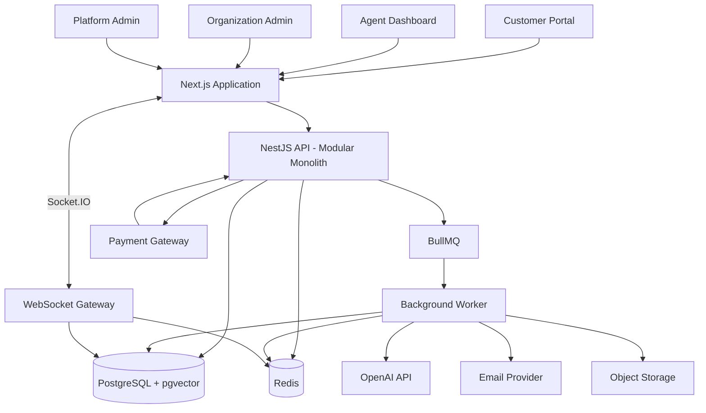

# High-Level Design (HLD)

# SupportAI

**Document Version:** 1.0  
**Architecture Style:** Modular Monolith (Initial Release)  
**Status:** Proposed

---

## 1. Introduction

This document describes the high-level architecture
of SupportAI.

It identifies major application components, their
responsibilities, communication mechanisms, data
storage, and external dependencies.

The initial architecture will use a modular monolith
with separately deployed frontend, API, and worker
applications.

The design will allow future extraction of independent
services when justified by operational requirements.

## 2. Architecture Goals

The architecture must:

1. Support multiple organizations.
2. Enforce tenant data isolation.
3. Support real-time communication.
4. Process asynchronous operations reliably.
5. Integrate AI and RAG capabilities.
6. Support subscription billing.
7. Allow horizontal scaling.
8. Be testable and maintainable.
9. Support production monitoring.
10. Allow gradual evolution toward microservices.

## 3. Architecture Overview

### 3.1 Client Layer

The client layer contains:

- Customer portal.
- Support agent dashboard.
- Organization administration dashboard.
- Platform super admin dashboard.

Technology:

- Next.js App Router.
- React.
- TypeScript.
- Tailwind CSS.
- TanStack Query.

Responsibilities:

- Display application interfaces.
- Manage user interactions.
- Communicate with backend APIs.
- Establish WebSocket connections.
- Handle client-side validation.
- Display real-time updates.

The frontend must never be trusted to enforce
authorization independently.

### 3.2 API Layer

Technology: NestJS.

The API layer handles:

- Authentication.
- Authorization.
- Request validation.
- Business logic.
- Database operations.
- External integrations.
- REST API endpoints.
- WebSocket gateways.

Initial modules:

- AuthModule
- UsersModule
- OrganizationsModule
- MembersModule
- InvitationsModule
- CustomersModule
- TicketsModule
- ConversationsModule
- AttachmentsModule
- KnowledgeBaseModule
- AiModule
- BillingModule
- NotificationsModule
- AnalyticsModule
- AuditLogsModule

Each module should expose clear interfaces and
avoid unnecessary direct dependencies on other modules.

### 3.3 Database Layer

Technology:

- PostgreSQL.
- Prisma ORM.
- pgvector extension.

Responsibilities:

- Persist application data.
- Enforce relational constraints.
- Support transactions.
- Store ticket conversations.
- Store organization data.
- Store billing records.
- Store AI execution metadata.
- Support vector similarity search.

### 3.4 Cache and Queue Layer

Technology:

- Redis.
- BullMQ.

Redis responsibilities:

- Cache frequently accessed data.
- Support distributed WebSocket coordination.
- Provide BullMQ queue storage.
- Support distributed rate limiting where appropriate.

BullMQ responsibilities:

- AI ticket analysis.
- Email delivery.
- Document ingestion.
- Embedding generation.
- Scheduled notifications.
- Analytics aggregation.

### 3.5 AI Layer

Technology:

- OpenAI API.
- Embedding models.
- pgvector.

Responsibilities:

- Classify tickets.
- Detect sentiment.
- Predict priority.
- Summarize conversations.
- Generate response suggestions.
- Retrieve relevant knowledge.
- Execute controlled AI tool workflows.

AI processing should be asynchronous when it is not
required to complete the immediate user request.

### 3.6 Real-Time Layer

Technology:

- NestJS WebSocket Gateway.
- Socket.IO.
- Redis adapter for multiple instances.

Responsibilities:

- Real-time messages.
- Typing indicators.
- Agent presence.
- Ticket assignment updates.
- Ticket status updates.

The database remains the source of truth.
WebSockets deliver notifications; they do not replace
persistent message storage.

### 3.7 External Integrations

The platform will integrate with:

- Transactional email provider.
- Payment gateway.
- OpenAI API.
- Object storage provider.

External providers must be accessed through
well-defined integration interfaces.

## 4. High-Level Architecture Diagram

## 5. Request Processing

### 5.1 Synchronous Request

Example: Creating a ticket.

1. Client sends a REST request.
2. API validates the request.
3. Authentication identifies the user.
4. Authorization checks organization access.
5. Ticket service executes business logic.
6. PostgreSQL persists the ticket.
7. A background job is scheduled if necessary.
8. API returns the created ticket.

### 5.2 Asynchronous AI Processing

Example: AI ticket classification.

1. Ticket is created.
2. An AI analysis job is queued.
3. API returns without waiting for AI.
4. Worker consumes the job.
5. Worker loads authorized ticket context.
6. AI provider processes the request.
7. Output is validated.
8. Results are persisted.
9. Agent dashboard receives a real-time update.

### 5.3 Real-Time Messaging

1. Client establishes authenticated WebSocket connection.
2. Server verifies user identity.
3. Server verifies ticket access.
4. Client sends a message.
5. Server validates authorization.
6. Message is persisted.
7. Server emits an event to authorized participants.
8. Offline users receive the message through normal
   database synchronization when reconnecting.

## 6. Multi-Tenant Architecture

SupportAI will use a shared database and shared schema
initially.

Each organization-owned record must include an
organization identifier where appropriate.

Tenant isolation must be enforced through:

- Organization membership validation.
- Tenant-scoped service methods.
- Tenant-aware database queries.
- Composite database constraints where appropriate.
- PostgreSQL Row-Level Security where appropriate.
- Automated tenant isolation tests.

The client must never be allowed to choose an arbitrary
organization identifier without server-side membership
verification.

## 7. Data Storage Strategy

| Data | Storage |
|------|---------|
| Users | PostgreSQL |
| Organizations | PostgreSQL |
| Tickets | PostgreSQL |
| Conversations | PostgreSQL |
| Audit logs | PostgreSQL |
| Subscriptions | PostgreSQL |
| Payments | PostgreSQL |
| Embeddings | PostgreSQL + pgvector |
| Cache | Redis |
| Background jobs | Redis/BullMQ |
| Attachments | Object storage |
| Application logs | Centralized logging system |

## 8. Security Architecture

Security controls include:

- Secure password hashing.
- JWT authentication.
- Refresh token rotation.
- Role and permission validation.
- Tenant isolation.
- Input validation.
- Rate limiting.
- Secure file uploads.
- Payment webhook signature verification.
- Secret management.
- Audit logging.
- AI tool authorization.
- Protection against prompt injection.

## 9. Scalability Strategy

Initial architecture:

- Stateless API instances where possible.
- Separate worker processes.
- PostgreSQL connection pooling.
- Redis caching.
- Background job queues.
- Object storage for file content.

Future architecture:

- Independently scaled AI service.
- Independently scaled notification service.
- Dedicated billing service.
- Dedicated real-time service.
- Kubernetes orchestration.
- Distributed tracing.
- Event-driven service communication.

Microservices will be introduced only after
documented architectural evaluation.

## 10. Reliability and Failure Handling

Examples:

- If OpenAI is unavailable, tickets must still be created.
- If email delivery fails, the job must be retried.
- If a WebSocket disconnects, messages must remain
  available through database synchronization.
- If payment webhooks are duplicated, billing state
  must not be applied twice.
- If a worker crashes, pending jobs must be recoverable.
- If a deployment fails, rollback must be possible.

## 11. Observability

The production system will collect:

- Structured application logs.
- API latency metrics.
- Error rates.
- Database connection metrics.
- Queue waiting and failure metrics.
- WebSocket connection metrics.
- AI latency and token usage.
- Payment webhook processing metrics.

Correlation IDs and distributed trace identifiers
will be used to follow requests across components.

## 12. Deployment Architecture

Development:
- Docker Compose.
- Local PostgreSQL.
- Local Redis.
- Next.js.
- NestJS API.
- Background worker.

Production:
- Containerized frontend.
- Containerized API.
- Independent worker deployment.
- Managed PostgreSQL.
- Managed Redis.
- Object storage.
- Kubernetes orchestration when operationally justified.

## 13. Future Microservices Evolution

Potential service boundaries:

- Authentication Service.
- Ticket Service.
- AI Service.
- Notification Service.
- Billing Service.
- Realtime Service.

The initial implementation remains modular.
Service extraction will be documented through ADRs
and supported by explicit communication contracts.
